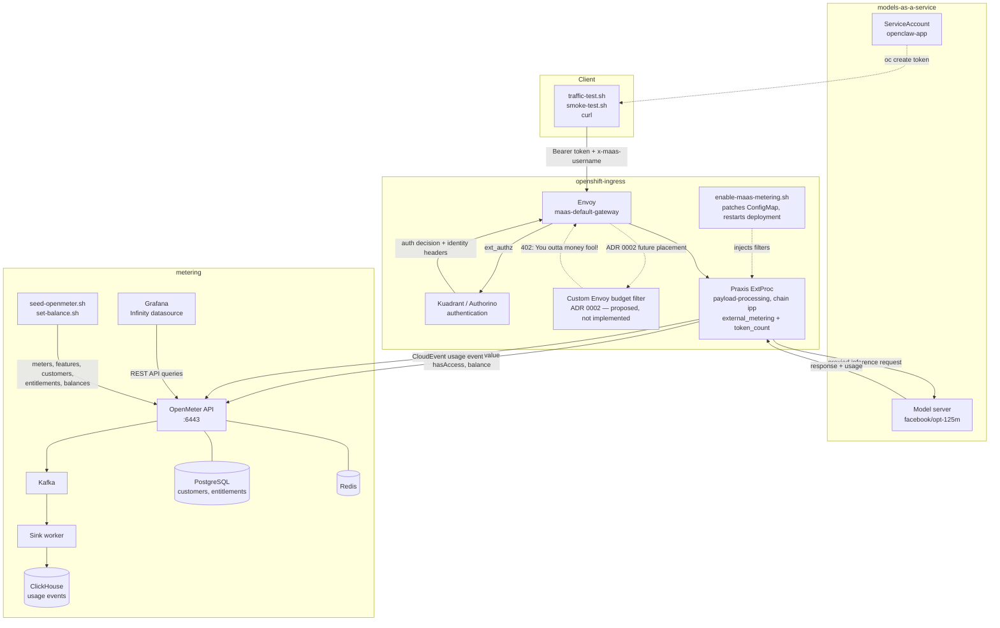

# metering-poc

Experimental proof-of-concept for AI Gateway / MaaS **usage metering talk-back**:

**Praxis** (token capture) → **CloudEvents** (GenAI-aligned) → **OpenMeter** (pricing + entitlement) → **talk-back API** (go/no-go).

This is **not** product code and is **not** a CI gate for [models-as-a-service](https://github.com/opendatahub-io/models-as-a-service).

## Start here

- **[ADR 0001 — PoC plan](docs/adr/0001-metering-poc-openmeter-talkback.md)** — detailed architecture, Praxis evaluation gates, OpenMeter pricing model, talk-back contract, and phased delivery.
- **[ADR 0002 — Envoy budget filter](docs/adr/0002-envoy-budget-filter.md)** — proposed post-Kuadrant Envoy filter that returns 402 when the authenticated user is over budget. Design only; not implemented.
- **[Metering tenant setup](docs/metering-tenant-setup.md)** — expected customer, subscription, entitlements, models and prices for one tenant, plus the command sequence that reproduces them.

Product intent lives in `models-as-a-service` under `METERING_PROPOSAL/` (`overview.md`, `talkback.md`).

## Architecture



The inference path is client → Envoy gateway → Praxis ExtProc → model. The
ExtProc's `external_metering` filter checks the subject's OpenMeter entitlement
before the call and emits a CloudEvent after the response; `token_count` supplies
the usage numbers. OpenMeter stores events through Kafka into ClickHouse and
keeps customers and entitlements in PostgreSQL. Grafana queries the OpenMeter
REST API with the Infinity datasource. The dashed budget-filter path is the
ADR 0002 proposal and is not deployed.

## Status

Phase 0 findings are recorded in ADR 0001 §13. The PoC runs end to end on the
cluster: the gateway reports usage, OpenMeter stores it, the meter aggregates
it, and an exhausted entitlement is enforced at the gateway with HTTP 402.

Deployment assets for the cluster PoC live under `deploy/` and `scripts/`:

- `deploy/openmeter/` — Helm values and install notes for OpenMeter on
  OpenShift, including its bundled ClickHouse, Kafka, PostgreSQL and Redis.
- `scripts/install-openmeter.sh` — install OpenMeter into the `metering`
  namespace. The API listens on port 6443 and is exposed through an edge route.
- `scripts/seed-openmeter.sh` — create the meter, feature, customer and
  metered entitlement that the gateway filter expects. Usernames must match
  OpenMeter's key regex (lowercase, digits, underscores).
- `scripts/enable-maas-metering.sh` — inject the `external_metering` and
  `token_count` filters into the `ipp` chain of the gateway ExtProc
  (`openshift-ingress`, deployment `payload-processing`). The script also
  sets `opendatahub.io/managed: "false"` on the ConfigMap and Deployment.
  `maas-controller` honours that, but `ai-gateway-controller` still re-renders
  on its 5-minute resync, so re-run the script after a reconcile.
- `deploy/maas/traffic-account.yaml` — ServiceAccount `openclaw-app` in
  `models-as-a-service`. `scripts/traffic-test.sh` mints a token for it and
  meters traffic as the OpenMeter subject `openclaw_app`.
- `scripts/smoke-test.sh` — send one inference request through the gateway and
  confirm OpenMeter received the usage event with non-zero token counts.
- `deploy/grafana/` and `scripts/install-grafana.sh` — Grafana in the `metering`
  namespace with the Infinity datasource pointed at the in-cluster OpenMeter
  API, plus a provisioned `OpenMeter usage` dashboard (tokens by subject,
  entitlement balance and usage for one subject, entitlements table, recent
  events). No Prometheus needed: OpenMeter exposes no `/metrics`, so the
  dashboard queries the REST API directly.

## Viewing usage in Grafana

```bash
./scripts/install-grafana.sh
oc get route grafana -n metering -o jsonpath='{.spec.host}'
```

Open `https://<host>` and pick the **OpenMeter usage** dashboard in the
OpenMeter folder. The `Subject` textbox (default `openclaw_app`) controls the
balance and usage panels. anonymous viewer access is enabled for the PoC; the admin password is in Secret
`grafana-admin` (the install script ends by printing the command that reads it).

The dashboard uses Grafana time-range macros (`${__from:date:iso}`,
`${__to:date:iso}`) against:

| Panel | OpenMeter endpoint |
| --- | --- |
| Tokens by subject | `GET /api/v1/meters/tokens_total/query?groupBy=subject` |
| Balance / usage | `GET /api/v1/customers/{subject}/entitlements/inference_tokens/value` |
| Entitlements | `GET /api/v1/entitlements` |
| Recent events | `GET /api/v1/events?from=&to=` |

The Infinity plugin is downloaded from grafana.com on first start
(`GF_INSTALL_PLUGINS`), so the pod needs egress to grafana.com. Grafana data is
on an `emptyDir`; dashboards and the datasource come from ConfigMaps, so a
restart re-provisions them.

The deployed MaaS ExtProc image (`quay.io/opendatahub/odh-praxis-extproc`)
already contains the Rust `external_metering` and `token_count` filters, so the
gateway side is a configuration change rather than a custom image build.

## Quick start

```bash
./scripts/install-openmeter.sh
./scripts/seed-openmeter.sh --user cluster_admin --grant 100000
./scripts/enable-maas-metering.sh
MAAS_API_KEY="$(oc whoami -t)" ./scripts/smoke-test.sh
```

Drive billable traffic as a ServiceAccount and exhaust its dollar budget:

```bash
oc apply -f deploy/maas/traffic-account.yaml
./scripts/set-balance.sh --user openclaw_app --dollars 5
./scripts/traffic-test.sh --count 20
```

`traffic-test.sh` mints its token with
`oc create token openclaw-app -n models-as-a-service --duration=1h`, so no
secret is stored. It sends `x-maas-username: openclaw_app` and stops at the
first HTTP 402.

Pass `--use-me` to meter as the current `oc` user instead: the token comes from
`oc whoami -t` and the subject defaults to `oc whoami` normalized to an
OpenMeter key. Set that subject's balance first, or override it with
`--username`.

## Container runtime

Prefer **Podman** for local compose. Docker-compatible commands are fine as an alternative (see ADR deploy notes).
